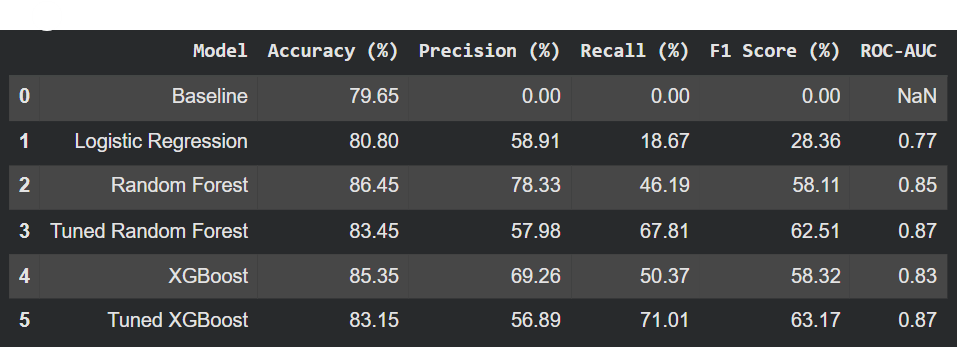

# Bank Customer Churn Prediction

## Project Overview

Customer churn occurs when customers stop doing business with a company. Predicting which customers are likely to leave can help banks develop targeted retention strategies.

This project uses exploratory data analysis (EDA) and machine learning to identify factors associated with customer churn and predict customers who may be at risk of leaving.

## Business Objectives

- Identify customer characteristics associated with churn.
- Explore patterns in customer demographics, account activity and product holdings.
- Build and compare machine learning classification models.
- Identify customers at risk of leaving and recommend potential retention strategies.

## Dataset

The dataset contains **10,000 customer records** with demographic, account and service-related information.

The target variable is `Exited`:

- `0` — Customer retained
- `1` — Customer churned

Approximately 20.37% of customers in the dataset had exited.

## Methodology

1. **Data preparation:** Inspected the dataset, excluded identifier fields and encoded categorical variables.
2. **Exploratory data analysis:** Examined churn patterns across age groups, product holdings, active-member status and geography.
3. **Feature preparation:** Split the data into training and testing sets using an 80:20 stratified split. Applied feature scaling for Logistic Regression.
4. **Model development:** Trained and evaluated Logistic Regression, Random Forest and XGBoost models, including tuned versions of Random Forest and XGBoost.
5. **Model evaluation:** Compared accuracy, precision, recall, F1-score and ROC-AUC. Used five-fold cross-validation and RandomizedSearchCV for hyperparameter tuning.
6. **Model interpretation:** Examined feature importance and used SHAP to understand how features influenced model predictions.
7. **Business recommendations:** Identified potential areas for further investigation and customer-retention initiatives.

## Key Findings

### 1. Churn Patterns by Age

Customers aged 50–59 recorded the highest churn rate at 56.04%. This suggests that age-related differences in customer needs and experiences warrant further investigation.


### 2. Geographic Differences

Germany recorded a substantially higher churn rate than France and Spain. Further investigation into customer experience, service accessibility and product suitability could help explain this difference.


## Model Performance

Five classification models were evaluated against a majority-class baseline.

| Model | Accuracy | Precision | Recall | ROC-AUC |
|---|---:|---:|---:|---:|
| Baseline | 79.65% | 0.00% | 0.00% | — |
| Logistic Regression | 80.80% | 58.91% | 18.67% | 0.775 |
| Random Forest | 86.45% | 78.33% | 46.19% | 0.853 |
| Tuned Random Forest | 83.45% | 57.98% | 67.81% | 0.865 |
| XGBoost | 85.35% | 69.26% | 50.37% | 0.833 |
| Tuned XGBoost | 83.15% | 56.89% | 71.01% | 0.871 |

Tuned XGBoost achieved the highest recall (71.01%) and ROC-AUC (0.871), while the untuned Random Forest achieved the highest accuracy (86.45%) and precision (78.33%).

The results demonstrate the trade-off between identifying more customers at risk of leaving and limiting unnecessary retention outreach.



## Model Interpretability

Feature importance and SHAP analysis highlighted the number of products held, age, active-member status and German geography as important predictive variables.

The SHAP summary plot illustrates how different feature values influence the model's predictions.


## Business Recommendations

- **Customer engagement:** Investigate why inactive customers have higher churn rates and develop targeted re-engagement initiatives.
- **Customer needs:** Review the needs of customers in age groups with elevated churn rates.
- **Product suitability:** Investigate the unusually high churn rates among customers holding three or four products, noting that these groups contain relatively few observations.
- **Geographic differences:** Examine customer feedback, service accessibility and product suitability in Germany.
- **Retention effectiveness:** Pilot targeted retention campaigns and measure their impact against a suitable control group.

## Limitations

- The dataset shows associations with churn but does not establish causation.
- The test set was used repeatedly during model development, so the reported test metrics may be optimistic.
- Further validation on an untouched dataset is needed before real-world deployment.

## Tools and Technologies

Python · Pandas · NumPy · Matplotlib · Seaborn · Scikit-learn · XGBoost · SHAP · Jupyter Notebook

## How to Run

1. Clone or download this repository.
2. Install the required libraries:

   ```bash
   pip install -r requirements.txt
   ```

3. Open `notebooks/Project_Notebook.ipynb` in Jupyter Notebook or Google Colab.
4. Run the notebook cells in sequence.

The notebook loads the dataset directly from this repository.
