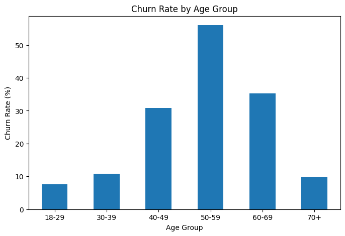
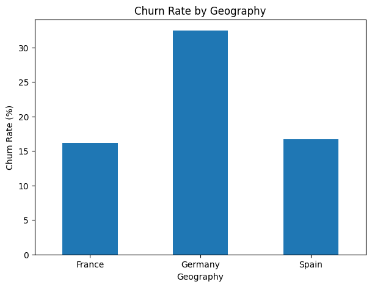
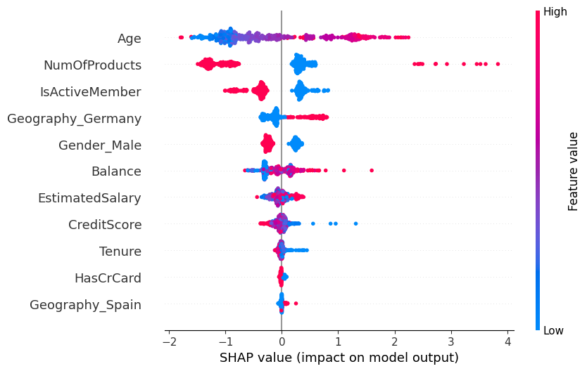

# Bank Customer Churn Prediction
An end-to-end project to identify customers at risk of leaving a bank, evaluate churn prediction models, and derive insights to support customer retention strategies.

## Project Overview

This project analyses banking customer data to investigate churn patterns, build classification models, and evaluate how effectively they identify customers who leave.

## Business Objectives

- Explore characteristics of customers with higher churn rates. 
- Compare classification models using accuracy, precision, recall and ROC-AUC.
- Investigate the customer characteristics associated with model predictions of high churn risk. 
- Use these findings to develop customer retention recommendations. 

## Dataset

The dataset contains **10,000 customer records** across France, Germany and Spain. It includes customer demographic, credit scores, account  balances, product holdings, account acgtivity and estimated salary.

The target variable is `Exited`:

- `0` — Customer retained
- `1` — Customer churned

Approximately 20.37% of customers in this dataset had exited.

## Methodology

1. **Data preparation:** Inspected the dataset, excluded identifier fields and encoded categorical variables.
2. **Exploratory data analysis:** Examined churn patterns across age groups, product holdings, account activity and geography.
3. **Feature preparation:** Created stratified 80:20 training and testing sets. Applied feature scaling for Logistic Regression.
4. **Model development and tuning:** Trained Logistic Regression, Random Forest and XGBoost classifiers. Used five-fold cross-validation and RandomizedSearchCV to tune selected models.
5. **Model evaluation:** Compared accuracy, precision, recall, F1-score and ROC-AUC to evaluate predictions and the trade-offs between models. 
6. **Model interpretation and business insights:** Used feature importance and SHAP analysis to investigate factors influencing predictions and identify potential customer-retention opportunities. 
## Key Findings

### 1. Churn Patterns by Age

Customers aged 50–59 recorded the highest churn rate at 56.04% significantly higher than other age groups. This suggests that age-related differences in customer needs and experiences require further investigation.



### 2. Geographic Differences

Germany recorded a churn rate of approximately 32.4%, nearly twice the rates ovserved in France and Spain. This suggests a need to investigate differences in customer experience, service accessibility and product suitability in the German market.



## Model Performance

Five classification models were evaluated against a majority-class baseline.

| Model | Accuracy | Precision | Recall | F1-score | ROC-AUC |
|---|---:|---:|---:|---:|---:|
| Baseline | 79.65% | 0.00% | 0.00% | 0.00% | — |
| Logistic Regression | 80.80% | 58.91% | 18.67% | 28.36% | 0.775 |
| Random Forest | 86.45% | 78.33% | 46.19% | 58.11% | 0.853 |
| Tuned Random Forest | 83.45% | 57.98% | 67.81% | 62.51% | 0.865 |
| XGBoost | 85.35% | 69.26% | 50.37% | 58.32% | 0.833 |
| Tuned XGBoost | 83.15% | 56.89% | 71.01% | 63.17% | 0.871 |

Tuned XGBoost achieved the highest recall (71.01%) and ROC-AUC (0.871), while the untuned Random Forest achieved the highest accuracy (86.45%) and precision (78.33%).

The results demonstrate the trade-off between identifying more customers at risk of leaving and limiting false-positive predictions. The preferred model depends on the bank's priorities and the cost of missed churners versus unnecessary retention outreach. 

## Key Predictors of customer churn. 

SHAP analysis identified the following features as the most influential in the model's predictions.
 - Age
 - Number of products held
 - Active-member status
 - Customers in Germany
   
The SHAP summary plot illustrates how individual feature values influence the model's predictions. This gives an idea why customers receive different churn-risk predictions. 



## Business Recommendations

- **Re-engaging Inactive Customers:** Contact inactive customers through personalised emails or relationship-manager calls to identify service difficulties and changing needs. Offer reelevant support and request feedback to address concernss before customers leave. 
- **Digital Support for Older Customers:** Offer customers aged 50-59 proactive relationship reviews, digital banking workshops and one-to-one guidance. Provide accessible support through phone and branch channels for customers who prefer traditional banking services. 
- **Product suitability:** Offer customers holding three or four products a personalised account review to assess whether their product combinations, fees and account-management arrangements remain suitable. Recommend adjustments where appropriate, treating this as a targeted initiative given the small number of customers in these groups. 
- **Improving customer retention in Germany:** Develop a Germany-focussed retention plan using customer feedback and complaint trends to identify service improvements. Tailor customer support and product communication to address the issues identified. 
- **Measuring Retention Campaign Effectiveness:** Start targeted retention campaigns against a suitable control group. Measure changes in churn, customer response, campaign costs and the value of customers retained before expanding successful initiatives.
  
## Limitations

- The dataset shows associations with churn but does not establish causation.
- The test set was used repeatedly during model development, so the reported test metrics may be optimistic.
- Further validation on an untouched dataset is needed before real-world deployment.

## Tools and Technologies

Python · Pandas · NumPy · Matplotlib · Seaborn · Scikit-learn · XGBoost · SHAP

## How to Run

1. Clone or download this repository.
2. Install the required libraries:

   ```bash
   pip install -r requirements.txt
   ```

3. Open `notebooks/Project_Notebook.ipynb` in Jupyter Notebook or Google Colab.
4. Run the notebook cells.

The notebook loads the dataset directly from this repository.
